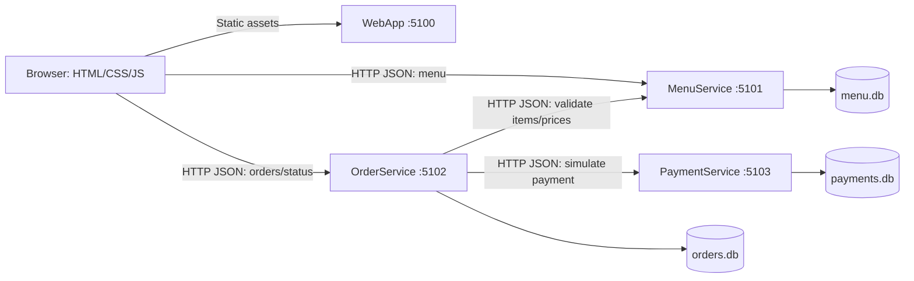

# Architecture overview — completed classroom baseline

The seven planned phases are complete. Use the [instructor walkthrough](classroom-demo.md)
to demonstrate this design and the [InventoryService handout](inventory-assignment.md)
for the student extension. InventoryService is proposed, not implemented.

## Boundaries and communication

The system implements MenuService CRUD, OrderService checkout/persistence,
simulated PaymentService checkout and WebApp's plain HTML/CSS/JavaScript interface.
OrderService saves Pending before calling payments,
then marks Paid on confirmed success. See [payment workflow](payment-service.md).
The WebApp host makes four runnable processes, but there are three business
microservices. Each project builds without project references to the others.
WebApp serves static assets and a read-only `/api/config` endpoint with public
browser-reachable MenuService and OrderService URLs. Browser JavaScript calls those
APIs directly; WebApp does not proxy checkout, contact PaymentService or own a database.
See [frontend behavior and failure handling](web-interface.md).
Each app now has its own multi-stage Dockerfile. Compose runs four non-root
processes on one project network; the business services exclusively mount their
own named SQLite volumes. Docker environment settings replace local paths and
service URLs. See [container networking and persistence](docker.md).
Each business service owns its own EF Core DbContext and SQLite file. Relationships
across services are identifiers carried in JSON, never cross-database foreign keys
or database queries. Small consumer-side DTOs make the HTTP contract explicit
without introducing a shared business-model library.

OrderService uses `IHttpClientFactory` clients with configured base URLs and finite
timeouts. Local URLs use localhost ports; Compose overrides them with service DNS
names and container ports. Browser URLs remain host-accessible: Docker service
names are not resolvable by the browser.
MenuService and OrderService allow one configured frontend origin in CORS,
defaulting to `http://localhost:5100`.
CORS is unnecessary for server-to-server calls and is not
authentication. No gateway or proxy is needed for this lesson.

## Deliberate simplifications

- The projects target .NET 10, with SDK selection pinned in `global.json` and
  EF Core 10 SQLite in each business service. The textbook's .NET 7 examples
  illustrate architecture; they do not set this project's target framework.
- API exploration uses REST Client `.http` files. No Swagger UI dependency is
  required; the HTTP request files make methods, payloads and status codes visible.
- Use local HTTP for this simulated classroom app to avoid certificate setup.
  Do not deploy its unauthenticated mutation APIs as a public ordering system.
- Each business service uses EF Core `EnsureCreatedAsync`. MenuService seeds only
  when its schema is first created. An existing empty menu stays empty after a restart.
  This keeps schema setup visible. It does not evolve existing schemas:
  recreate disposable demo databases after model changes, or introduce migrations
  deliberately before retaining data across schema changes. Do not mix both approaches.
- Use C# `decimal` for currency calculations with an explicit two-decimal policy;
  avoid floating point. SQLite has limitations for decimal comparisons and sorting:
  use integer cents for stored monetary values with decimal conversion at API boundaries.
- Keep item names and unit prices as order snapshots. Later menu edits or deletion
  must not rewrite a customer's order history. The server accepts item IDs and
  quantities, then obtains prices from MenuService.
- Treat a definite payment decline differently from an unknown payment outcome.
  Keep the order Pending and return its ID with a clear payment outcome. Restrict
  staff status transitions so an unconfirmed payment cannot become Paid or enter
  preparation merely through an arbitrary status update.
- Payment deduplication must use a database unique constraint, not just an
  in-memory check. Use a stable order/payment key for retries; return the existing
  payment for identical input and reject conflicting amount/method input. This
  does not deduplicate separate customer order submissions; explain that limit.

## Checkout and failures

1. Validate customer name, positive quantities, payment method and bounded input.
2. Retrieve each requested item from MenuService over HTTP; validate availability
   and calculate the total. If the service is unavailable, return a clear temporary
   failure without creating an order. Missing or unavailable items are client errors.
3. Save a Pending order and its item snapshots in OrderService's database.
4. Call PaymentService with the order ID, server-calculated amount, simulated
   method (`Credit Card` or `Dining Dollars`) and stable payment key.
5. Mark Paid only after a confirmed success. On a confirmed decline retain Pending
   with an explicit declined outcome. Configurable simulation modes need no real
   card numbers or account information.
6. If the request times out, payment may have committed even though its response
   was lost. Keep Pending and report the outcome as unknown, including the order ID.
   Reconcile through OrderService's payment reconciliation endpoint (which reads
   PaymentService's payment-by-order endpoint), or replay the exact payment request;
   never automatically issue a fresh payment key after a timeout.

There is no atomic transaction spanning orders and payments. A crash after successful
payment but before the Paid update leaves a paid payment and a Pending order. A
failed response to the browser can also lead to a duplicate order if the customer
submits again. Payment deduplication solves only repeated payment requests for the
same key. Automatic reconciliation, order-submission idempotency, durable messaging,
and distributed transactions are outside the initial scope. Menu availability may
also change between validation and payment; no stock reservation exists yet.

Business services emit structured JSON console logs with ASP.NET Core/HttpClient
activity, order IDs, payment keys and important errors. Incoming request logs show
method/path/status/duration without bodies or payment credentials. Dependency
timeouts return explicit failure/uncertainty responses. Compose mounts one separate
SQLite volume per owning service; database directories are not shared. SQLite is appropriate for one demo
instance per service, not unrestricted horizontal write scaling.

## InventoryService extension point

The stock check will fit between menu validation and Pending order creation in
OrderService's checkout workflow. Students will implement a separate HTTP service,
database and client integration. MenuService's `IsAvailable` currently indicates
whether an item can be ordered; students should decide how that relates to inventory
as the authoritative source of stock. A separate check followed by decrement can
oversell under concurrent requests, so discuss an atomic reservation/decrement API
and release behavior after payment failure. No InventoryService code, project or
database is included in the baseline. The [student assignment](inventory-assignment.md)
separates a core stock-validation milestone from an optional reservation extension.

## References

- [Microsoft microservices architecture textbook](https://learn.microsoft.com/en-us/dotnet/architecture/microservices/) — concepts and independently deployable services; published examples target .NET 7.
- [.NET support policy](https://dotnet.microsoft.com/en-us/platform/support/policy/dotnet-core) — .NET 10 is LTS.
- [EF Core 10 requirements](https://learn.microsoft.com/en-us/ef/core/what-is-new/ef-core-10.0/whatsnew) — targets .NET 10.
- [EF Core SQLite provider](https://learn.microsoft.com/en-us/ef/core/providers/sqlite/) and [limitations](https://learn.microsoft.com/en-us/ef/core/providers/sqlite/limitations).
- [Seekers Café location](https://css.mydininghub.com/en/location/seekers-cafe-and-coffee) — supplied campus context; no live menu was verified or imported.
