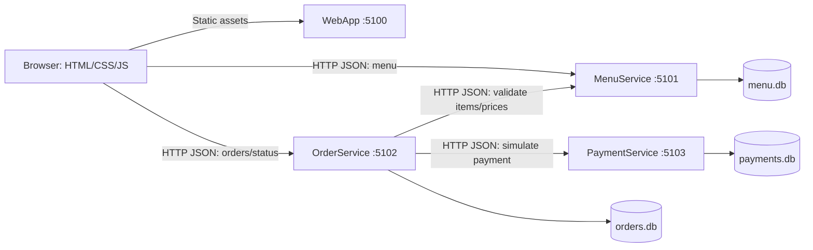

# Architecture decisions — Phases 1–3

## Boundaries and communication

This is the target flow. MenuService CRUD and OrderService checkout/persistence
are implemented. PaymentService and WebApp still expose only identity endpoints.
OrderService saves Pending orders; the payment call is deferred to Phase 4.
The WebApp host makes four runnable processes, but there are three business
microservices. Each project builds without project references to the others.
Each service will have its own EF Core DbContext and SQLite file. Relationships
across services are identifiers carried in JSON, never cross-database foreign keys
or database queries. Small consumer-side DTOs make the HTTP contract explicit
without introducing a shared business-model library.

Use `IHttpClientFactory` clients in OrderService, with base URLs read from
configuration and finite timeouts. Local URLs will be localhost ports; Compose
will override them with service DNS names and container ports. Browser URLs must
remain host-accessible: Docker service names are not resolvable by the browser.
MenuService and OrderService allow only `http://localhost:5100` in CORS.
CORS is unnecessary for server-to-server calls and is not
authentication. No gateway or proxy is needed for this lesson.

## Recommended simplifications and corrections

- Use .NET 10, the newest installed stable LTS SDK, with EF Core 10 SQLite.
  Add packages only in the phase that uses them. The textbook's .NET 7 examples
  illustrate architecture; they do not set this project's target framework.
- Use REST Client `.http` files first. OpenAPI generation can be added alongside
  the business APIs if useful; an interactive Swagger UI is optional.
- Use local HTTP for this simulated classroom app to avoid certificate setup.
  Do not deploy its unauthenticated mutation APIs as a public ordering system.
- Start with EF Core `EnsureCreatedAsync` and seed only when the database schema
  is first created in Phase 2. An existing empty menu stays empty after a restart.
  This keeps schema setup visible. It does not evolve existing schemas:
  recreate disposable demo databases after model changes, or introduce migrations
  deliberately before retaining data across schema changes. Do not mix both approaches.
- Use C# `decimal` for currency calculations with an explicit two-decimal policy;
  avoid floating point. SQLite has limitations for decimal comparisons and sorting:
  use integer cents for stored monetary values with decimal conversion at API boundaries.
- Keep item names and unit prices as order snapshots. Later menu edits or deletion
  must not rewrite a customer's order history. The server accepts item IDs and
  quantities, then obtains prices from MenuService.
- Treat a definite payment decline differently from an unknown payment outcome.
  Keep the order Pending and return its ID with a clear payment outcome. Restrict
  staff status transitions so an unconfirmed payment cannot become Paid or enter
  preparation merely through an arbitrary status update.
- Payment deduplication must use a database unique constraint, not just an
  in-memory check. Use a stable order/payment key for retries; return the existing
  payment for identical input and reject conflicting amount/method input. This
  does not deduplicate separate customer order submissions; explain that limit.

## Planned checkout and failures

1. Validate customer name, positive quantities, payment method and bounded input.
2. Retrieve each requested item from MenuService over HTTP; validate availability
   and calculate the total. If the service is unavailable, return a clear temporary
   failure without creating an order. Missing or unavailable items are client errors.
3. Save a Pending order and its item snapshots in OrderService's database.
4. Call PaymentService with the order ID, server-calculated amount, simulated
   method (`Credit Card` or `Dining Dollars`) and stable payment key.
5. Mark Paid only after a confirmed success. On a confirmed decline retain Pending
   with an explicit declined outcome. A configurable demo decline mode will require
   no real card numbers or account information.
6. If the request times out, payment may have committed even though its response
   was lost. Keep Pending and report the outcome as unknown, including the order ID.
   Reconcile through the payment-by-order endpoint or retry using the same key;
   never automatically issue a fresh payment key after a timeout.

There is no atomic transaction spanning orders and payments. A crash after successful
payment but before the Paid update leaves a paid payment and a Pending order. A
failed response to the browser can also lead to a duplicate order if the customer
submits again. Payment deduplication solves only repeated payment requests for the
same key. Automatic reconciliation, order-submission idempotency, durable messaging,
and distributed transactions are outside the initial scope. Menu availability may
also change between validation and payment; no stock reservation exists yet.

Use structured ASP.NET Core/HttpClient logging, adding order IDs and payment keys
to workflow messages as implemented. Log incoming method/path/status/duration and
dependency failures without logging request bodies or payment credentials.
Timeouts and cancellation should produce clear responses rather than raw exceptions.
In Phase 6, mount one separate SQLite volume per owning service. Do not share
database directories between containers. SQLite is appropriate for one demo
instance per service, not unrestricted horizontal write scaling.

## InventoryService extension point

The stock check will fit between menu validation and Pending order creation in
OrderService's checkout workflow. Students will implement a separate HTTP service,
database and client integration. MenuService's `IsAvailable` currently indicates
whether an item can be ordered; students should decide how that relates to inventory
as the authoritative source of stock. A separate check followed by decrement can
oversell under concurrent requests, so discuss an atomic reservation/decrement API
and release behavior after payment failure. No InventoryService code, project or
database is created in this milestone.

## References

- [Microsoft microservices architecture textbook](https://learn.microsoft.com/en-us/dotnet/architecture/microservices/) — concepts and independently deployable services; published examples target .NET 7.
- [.NET support policy](https://dotnet.microsoft.com/en-us/platform/support/policy/dotnet-core) — .NET 10 is LTS.
- [EF Core 10 requirements](https://learn.microsoft.com/en-us/ef/core/what-is-new/ef-core-10.0/whatsnew) — targets .NET 10.
- [EF Core SQLite provider](https://learn.microsoft.com/en-us/ef/core/providers/sqlite/) and [limitations](https://learn.microsoft.com/en-us/ef/core/providers/sqlite/limitations).
- [Seekers Café location](https://css.mydininghub.com/en/location/seekers-cafe-and-coffee) — supplied campus context; no live menu was verified or imported.
